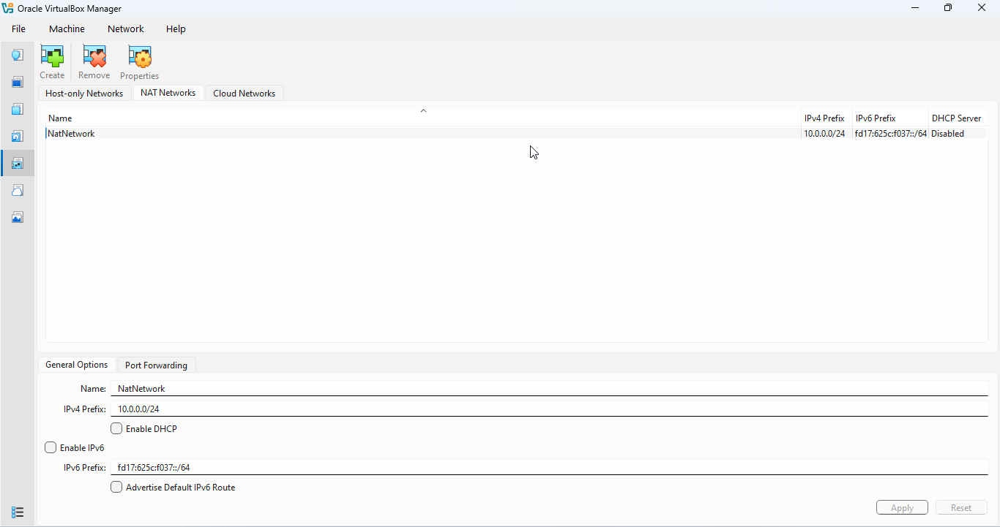
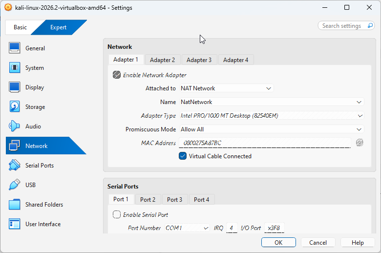
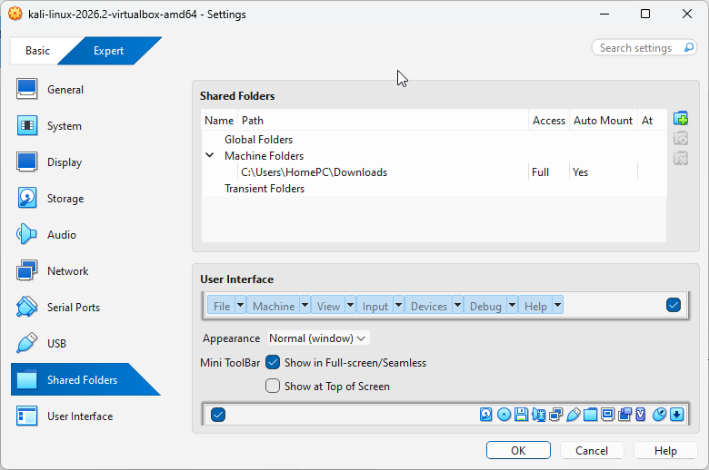
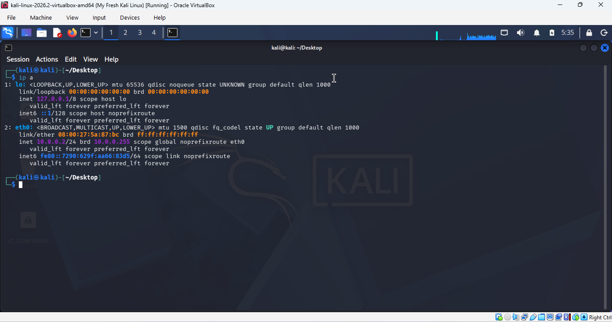
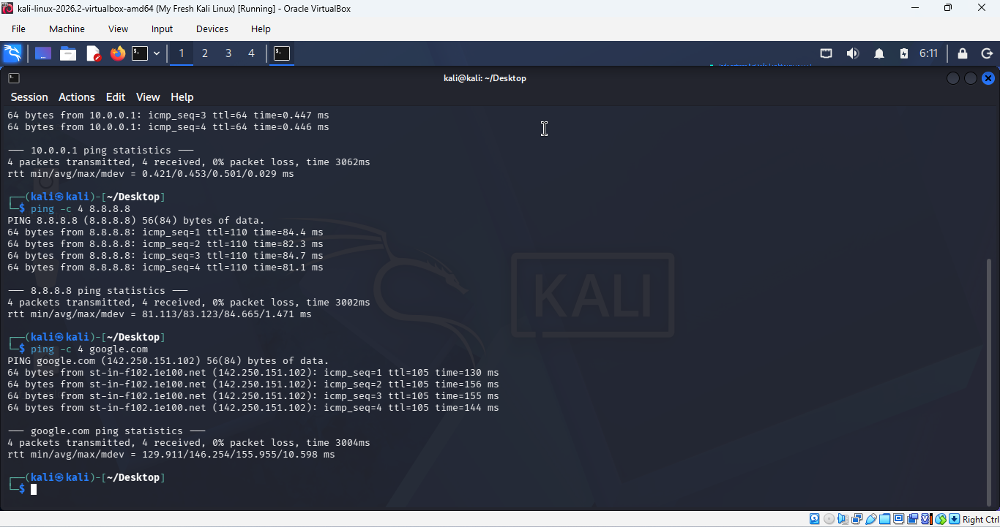
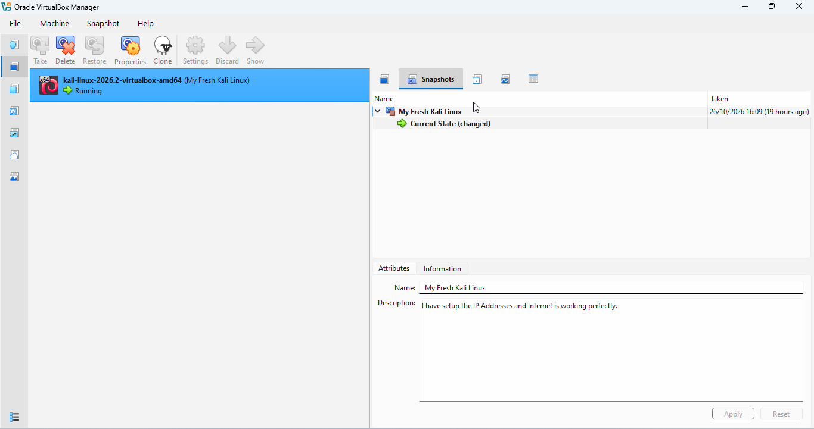

# Cybersecurity-Lab-Setup

A hands-on Cybersecurity lab environment built with Oracle VirtualBox and Kali Linux. This repository documents my set-up, configurations, screenshots, and tools for learning ethical hacking, penetration testing, and security research in a safe, isolated virtual environment.

**Week 1 | Project: WK1-PM1 | Tools: VirtualBox, Kali Linux**

## Objectives
- Install and configure VirtualBox
- Set up Kali Linux as a virtual machine
- Create a NAT Network (10.0.0.0/24)
- Assign Kali a static IP of 10.0.0.2/24
- Enable clipboard and drag-and-drop, and a shared folder
- Confirm full internet access
- Take a snapshot as a recovery point

## Lab Architecture 

## Lab Configuration
| Component | Setting |
|---|---|
| Host OS | [Windows 10/11] |
| Host RAM | [e.g. 8 GB] |
| Hypervisor | VirtualBox [version] |
| Guest OS | Kali Linux [version] |
| Network | NatNetwork |
| Network address | 10.0.0.0/24 |
| Kali IP | 10.0.0.2/24 |

## Setup Steps

### Step 1: Install 7-Zip
Installed 7-Zip to extract the Kali Linux virtual machine package, which is downloaded as a `.7z` archive.

### Step 2: Install VirtualBox 
Installed Oracle VirtualBox as the hypervisior to run the virtual machines.

### Step 3: Create the NAT Network
Created a NAT Network named NatNetwork with the range 10.0.0.0/24.

### Step 4: Import Kali Linux
Imported the Kali Linux VM and attached its adapter to NatNetwork.

### Step 5: Clipboard, Drag and Drop, Shared Folder
Set Shared Clipboard and Drag'n'Drop to Bidirectional and created a shared folder named /downloads.

### Step 6: Configure the Kali IP Address
Set the static IP 10.0.0.2/2VirtualBox_XC2YtzhhoH.png4 on Kali.

### Step 7: Test Connectivity
Ran `ping -c 4 8.8.8.8` and `ping -c 4 google.com` to confirm internet access and DNS.

### Step 8: Take a Snapshot
Took a snapshot named **My Fresh Kali Linux** as a clean baseline to restore if anything breaks.

## Problems Encountered and Solutions
- **Problem:** [Static IP 10.0.0.2 failed "IP configuration could not be reserved". The NAT Network's DCHP server was using that address, and Kali had been assigned 10.0.0.3.]
- **Solution:** [Disabling DHCP on the NAT Network fixed it.]

## What I Learned
- How a NAT Network lets VMs talk to each other and the internet
- How to set and verify a static IP
- Why snapshots matter before risky experiments
- Why documenting each step is part of professional security work

## Ethical Use
This lab is for learning only. I only test systems I own or have permission to test.

## Author
**Maijem**
Cybersecurity Intern, [program name]
