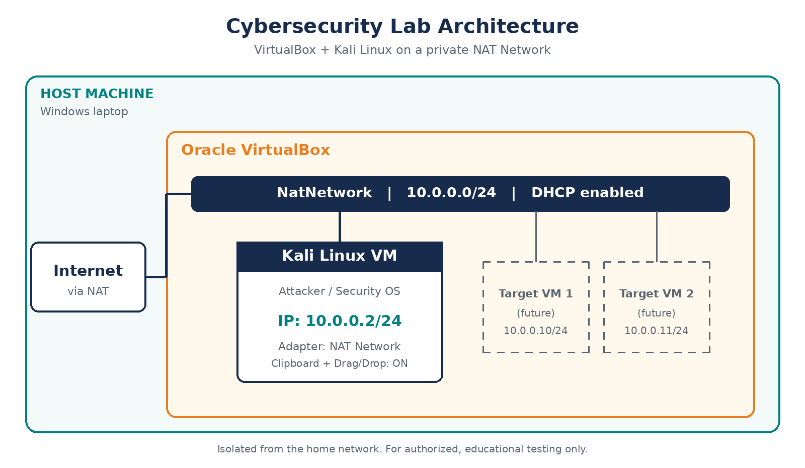

# 🖥️ Cybersecurity-Lab-Setup

A hands-on Cybersecurity lab environment built with Oracle VirtualBox and Kali Linux. This repository documents my set-up, configurations, screenshots, and tools for learning ethical hacking, penetration testing, and security research in a safe, isolated virtual environment.


## 📌 Project Overview

For Week 1 of my internship, I built a self-contained practice environment for cybersecurity work on my own laptop. It runs Kali Linux inside Oracle VirtualBox, so anything I try stays inside the virtual machine and never touches my Windows system or my home network.

I connected the VM to a private network of its own (NatNetwork, 10.0.0.0/24) and gave Kali a fixed address of 10.0.0.2. Having the machine on a known address makes it easier to document, test, and reuse in later tasks, and other machines can join the same network when I need targets to practise on.

By the end, I had a working Kali VM with internet access, file sharing with Windows, and a saved snapshot I can return to whenever I need a clean start.

## 🎯 Objectives
- Install and configure VirtualBox
- Set up Kali Linux as a virtual machine
- Create a NAT Network (10.0.0.0/24)
- Assign Kali a static IP of 10.0.0.2/24
- Enable clipboard and drag-and-drop, and a shared folder
- Confirm full internet access
- Take a snapshot as a recovery point

 ## 🏗️ Lab Architecture



## ⚙️ Lab Configuration
| 🧩 Component | ⚙️ Setting |
|---|---|
| 🖥️ Host OS | [Windows 10/11] |
| 🧠 Host RAM | [e.g. 8 GB] |
| 🧰 Hypervisor | VirtualBox [version] |
| 🐉 Guest OS | Kali Linux [version] |
| 🌐 Network | NatNetwork |
| 📡 Network address | 10.0.0.0/24 |
| 📍 Kali IP | 10.0.0.2/24 |

## 🪜 Setup Steps

### 🟣 Step 1: Install 7-Zip
Installed 7-Zip to extract the Kali Linux virtual machine package, which is downloaded as a `.7z` archive.

### 🔵 Step 2: Install VirtualBox 
Installed Oracle VirtualBox as the hypervisior to run the virtual machines.

### 🟢 Step 3: Create the NAT Network
Created a NAT Network named NatNetwork with the range 10.0.0.0/24.


### 🟠 Step 4: Import Kali Linux
Imported the Kali Linux VM and attached its adapter to NatNetwork.


### 🟡 Step 5: Clipboard, Drag and Drop, Shared Folder
Set Shared Clipboard and Drag'n'Drop to Bidirectional and created a shared folder named /downloads.


### 🔴 Step 6: Configure the Kali IP Address
Set the static IP 10.0.0.2/2VirtualBox_XC2YtzhhoH.png4 on Kali.


### 🟤 Step 7: Test Connectivity
Ran `ping -c 4 8.8.8.8` and `ping -c 4 google.com` to confirm internet access and DNS.


### 🟣 Step 8: Take a Snapshot
Took a snapshot named **My Fresh Kali Linux** as a clean baseline to restore if anything breaks.


## 🔎 Lab Verification

| ✅ Test | 💻 Command | 🎯 Result |
|---|---|---|
| 🌐 Check Kali's IP address | `ip a` | 10.0.0.2/24 shown |
| 🌍 Test internet connectivity | `ping -c 4 8.8.8.8` | Replies received |
| 🔤 Test DNS resolution | `ping -c 4 google.com` | Name resolved, replies received |
| 🐉 Check Kali version | `cat /etc/os-release` | Version 2026.2 shown |
| 📸 Confirm the snapshot | VirtualBox Snapshots tab | **My Fresh Kali Linux** listed |

## 🐞 Problems Encountered and Solutions

### Problem: Setting the static IP address on Kali
Kali was getting its address automatically from DHCP, so I needed a way to set the fixed IP 10.0.0.2/24 required for the lab.

**Solution:** I opened the Network Connections editor from the terminal:

```bash
nm-connection-editor &
```

The `&` runs it in the background so the terminal stays usable. In the editor I:
1. Selected the wired connection and clicked the **gear icon** (Edit).
2. Opened the **IPv4 Settings** tab and set the method to **Manual**.
3. Entered the address 10.0.0.2, netmask 24, and the gateway and DNS server [fill in what you used].
4. Saved, then disconnected and reconnected the network.

I checked it with `ip a` (10.0.0.2/24 shown) and `ping -c 4 8.8.8.8` (replies received).

## 💡 What I Learned
- 🌐 How a NAT Network lets VMs talk to each other and the internet
- 📍 How to set and verify a static IP
- 📸 Why snapshots matter before risky experiments
- 📝 Why documenting each step is part of professional security work

## 🔐 Ethical Use
This lab is for learning only. I only test systems I own or have permission to test.

## 🧰 Tools Used

| 🛠️ Tool | 📝 Purpose | 🔗 Website |
|---|---|---|
| 7-Zip | Extracting the Kali Linux VM package | [7-zip.org](https://www.7-zip.org/download.html) |
| Oracle VirtualBox | Running the virtual machines | [virtualbox.org](https://www.virtualbox.org/wiki/Downloads) |
| Kali Linux | Security-focused operating system for the lab | [kali.org](https://www.kali.org/get-kali/) |
| GitHub | Hosting and documenting the project | [github.com](https://github.com) |
| Shields.io | Creating the badges at the top of this README | [shields.io](https://shields.io) |
| ShareX | Recording the screen and capturing screenshots of the lab | [getsharex.com](https://getsharex.com) |

---

## 👤 Author

**Obioma Chimaijem**
Cybersecurity Intern at NETWORKWALKS | Batch B084

LinkedIn: https://www.linkedin.com/in/chimaijem-obioma-15aa85315/

---

## 📌 Project Information

**Program Name:** Cybersecurity at NETWORKWALKS (Batch B084) | **Week:** 01 | **Project:** Cybersecurity & Pentesting Lab Setup (WK1-PM1) | **Repository:** GitHub
